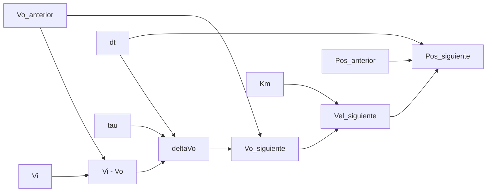

# Motor DC: Python → C++ para Visual Studio 2008

Implementación de la práctica adjunta: simulación de un motor DC mediante Euler,
entrada de órdenes y temporizador Win32. Python genera el modelo de cálculo;
el ejecutable resultante es C++03 y **no necesita Python**.

## Abrir en Visual Studio 2008

1. Abre **`INFO2_P1.sln` de la raíz** con Visual Studio 2008 y soporte de C++.
   La solución de `original/` es únicamente el material recibido, incompleto.
2. Elige `Debug | Win32` o `Release | Win32` y compila con F7.
3. Ejecuta con Ctrl+F5. Introduce una orden por línea:

   ```text
   3 1
   1 100
   2 10
   0
   ```

   `3 Vi` cambia la tensión en voltios; `1 Km`, la ganancia en rpm/V;
   `2 tau`, la constante de tiempo en segundos; `0` termina el programa.
   Usa punto decimal. Se admiten tensiones negativas.

El motor comienza en reposo, con `Vi=0 V`, `Km=100 rpm/V`, `tau=10 s` y muestreo
de `1000 ms`. La primera fila de la consola muestra tensión, velocidad y posición.
Los cambios de parámetros y los pasos del temporizador se protegen con una
sección crítica. Al salir se espera a que terminen los callbacks.

También puedes ejecutar `tools\build_vs2008.cmd`: carga el entorno de VS2008,
compila Release, ejecuta las pruebas C++ y guarda una simulación de ejemplo en
`build\response_vs2008.csv`. Requiere que el instalador de Visual Studio haya
definido `VS90COMNTOOLS`. Este script debe validarse en Windows; no fue ejecutado
en el entorno Linux.

## Desarrollar y probar en la nube

Se necesitan **Python 3.8+ y GCC con soporte de C++03**. No hay paquetes Python
externos, servicios, claves ni acceso de red necesarios para construir o probar.

Desde la raíz del repositorio:

```sh
python3 tools/dev.py test
python3 tools/dev.py test --sanitize
./build/motor --simulate 20
./build/motor --simulate 100 2 10 100 100 > build/respuesta.csv
```

El último comando simula 100 pasos con `Vi=2 V`, `tau=10 s`, `Km=100 rpm/V` y
`dt=100 ms`. El CSV incluye el estado inicial y una fila por paso.
El modo `--simulate` usa tiempo simulado, sin esperas ni temporizadores reales,
y está disponible tanto en Linux como en Windows. En Linux, este es el modo de
ejecución; la consola interactiva con temporizador utiliza la API de Windows.

`tools/dev.py build` sólo compila. Puedes seleccionar otro compilador compatible
con las opciones de GCC mediante `CXX`. Las pruebas verifican también que la
cabecera generada esté actualizada. Para modificar el modelo:

```sh
python3 tools/generate_model.py
python3 tools/generate_model.py --check
```

Edita primero `model/motor.json` y regenera. Conserva en Git tanto el modelo como
`INFO2_P1/MotorModel_generated.h`, de modo que VS2008 pueda compilar sin Python.
El generador no es un traductor general de Python a C++; transforma un modelo
JSON de operaciones y dependencias en tablas y un evaluador C++03.

Para probar también el código Windows desde Kali, consulta
[la guía de MinGW, Wine y VS2008](docs/kali-vs2008.md). Con MinGW i686 y Wine32
instalados, `python3 tools/test_win32.py` compila los ejecutables Windows,
ejecuta las pruebas del núcleo, las de la CLI y 29 comprobaciones del temporizador
real de la API Win32. Estas últimas verifican movimiento, órdenes, parada,
reinicio y destrucción con callbacks pendientes. `--compile-only` comprueba
la compilación sin ejecutar Wine; `--arch win64` permite probar la variante de
64 bits por separado. Este flujo no utiliza el compilador de Microsoft.

## Modelo y grafo dirigido

Con `dt = T_ms / 1000`, se aplican las ecuaciones del enunciado:

```text
deltaVo = (Vi - Vo) * dt / tau
Vo_siguiente = Vo + deltaVo
Vel_siguiente = Vo_siguiente * Km
Pos_siguiente = Pos + Vel_siguiente * 6 * dt
```

La posición es una ampliación de la plantilla: acumula grados sin limitarse a
una vuelta. El factor `6` convierte rpm a grados por segundo; se integra con la
velocidad del final del paso. El PDF prescribe las ecuaciones de tensión y
velocidad, pero no impone este método de integración de posición.

El grafo representa **dependencias de cálculo**, no conexiones físicas del motor:



`DirectedGraph.h` implementa **Kahn**: cuenta las dependencias pendientes, encola
los nodos de grado de entrada cero y los procesa liberando sus sucesores. Si no
puede visitar todos los nodos, hay un ciclo. Su coste es `O(V + E)`. El evaluador
C++ usa este orden en cada paso; el generador Python también valida el grafo.
El estado anterior entra como dato y el siguiente sale como resultado, evitando
crear un ciclo por la realimentación entre instantes.

## Memoria, entradas y límites

- El núcleo y el grafo utilizan estructuras por valor y arrays de capacidad
  fija, sin `new`, `delete` ni punteros propietarios. Los punteros de la API son
  referencias prestadas a datos del llamador, y se comprueban antes de usarlos.
- Capacidad: 64 nodos y 128 aristas. El modelo actual tiene 15 nodos y 16 aristas.
- Órdenes de hasta 49 caracteres, más el fin de línea. Se rechazan órdenes
  desconocidas, argumentos de más o de menos, basura, NaN e infinitos.
- Se exige `tau>0`, `Km>=0` y `0<dt<=tau`, todos finitos. Esta restricción de
  muestreo evita la oscilación numérica de Euler; el enunciado recomienda un
  paso entre 5 y 10 veces inferior a `tau` para mejorar la aproximación.
- Si un cálculo desborda, el paso se rechaza sin cambiar el estado. La CLI
  devuelve error y la consola Windows lo muestra; no se recorta el resultado.
- Cada callback avanza un paso fijo. El temporizador de Windows no ofrece
  garantías de tiempo real ni corrige retrasos de planificación.

## Validación y procedencia

En Linux se validó la compilación estricta C++03 con GCC 14.2, 1536
comprobaciones C++ y 26 pruebas Python, también con AddressSanitizer y
UndefinedBehaviorSanitizer. Las pruebas contrastan la respuesta con
`Vo(n)=Vi*(1-(1-dt/tau)^n)` desde reposo, la convergencia, signos y unidades,
cambios de parámetros, errores de entrada, ciclos y desbordamientos.

Además, MinGW GCC 12-posix compiló los tres ejecutables para Windows de 32 y
64 bits en C++03 estricto. Bajo Wine64 8.0 pasaron las 1536 comprobaciones del
núcleo, las 29 del temporizador y las 7 pruebas de la CLI. La ejecución de 32
bits quedó bloqueada porque el kernel de nube no arranca el runtime ELF32 de
Wine32. No se comprobó visualmente la consola en esta ejecución sin escritorio.

**MSVC 2008 y Windows nativo siguen pendientes de validación.** MinGW y Wine no
demuestran compatibilidad completa con ese compilador ni con su SDK. Se
conservan los formatos `.sln` 10 y `.vcproj` 9, Win32, sin dependencias modernas
ni generación previa obligatoria. Los comandos, resultados y alternativas están
en [la guía de Kali](docs/kali-vs2008.md).

`original/P1_VersionC_alumno/` conserva los fuentes, la solución y el PDF del
ZIP sin modificar sus bytes. Se omiten los ejecutables, objetos, cachés y
preferencias personales que venían en él. Los materiales originales atribuyen
el código a Esteban del Castillo y Ernest Gil. Las instrucciones del PDF se
usaron como requisitos de la práctica; el generador y el grafo responden a la
ampliación solicitada por el usuario.

Consulta [la configuración reutilizable de nube](docs/cloud-setup.md) para
preparar futuras tareas.
